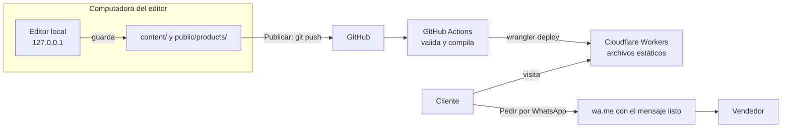

# Stock One

Catálogo de zapatos y sneakers de diferentes marcas, con pedidos por WhatsApp. Es un sitio 100 % estático con un editor local que
reemplaza al panel de administración: sin login, sin base de datos y con costo cero de hosting.

## Cómo funciona



El botón de pedido usa un enlace `wa.me` con texto prellenado, así que no necesita la API de WhatsApp.
El vendedor recibe la marca, el modelo, el precio y el enlace del producto, y gestiona la venta en el chat.

## Decisiones

| Decisión | Motivo |
| --- | --- |
| Next.js con `output: "export"` | HTML estático por producto, bueno para SEO y sin servidor |
| Git como base de datos | Historial, respaldo y reversión gratis, sin nada expuesto a internet |
| Editor local en vez de panel web | Evita login, sesiones y una superficie de ataque pública |
| Cloudflare Workers Static Assets | Peticiones estáticas gratis e ilimitadas, uso comercial permitido y ruta recomendada para proyectos nuevos |
| GitHub Actions para desplegar | El equipo del editor solo necesita acceso a GitHub, nunca credenciales de Cloudflare |
| Precios en centavos | Evita errores de redondeo con decimales |
| Marcas como entidad propia | Filtro principal de la tienda; renombrar una marca no rompe sus productos y "Próximamente" la anuncia sin mostrar productos |
| Paleta en un solo archivo | Los colores del manual viven en `src/styles/theme.css` y nada más |

## Estructura

```text
content/            Productos, marcas y datos de la tienda
public/products/    Fotos optimizadas por el editor
public/_headers     Cabeceras de seguridad para Cloudflare
src/                Sitio público
editor/             Editor local: servidor (Hono) e interfaz
scripts/            CSP por página e instalador para Windows
brand/              Manual de marca y destino de los logos
tests/              Pruebas de seguridad, datos y publicación
docs/               Guías de despliegue, edición y seguridad
```

## Comandos

| Comando | Qué hace |
| --- | --- |
| `pnpm dev` | Sitio en modo desarrollo |
| `pnpm editor` | Abre el editor de catálogo |
| `pnpm check` | Tipos, lint y pruebas |
| `pnpm build` | Compila a `out/` y aplica la CSP |
| `pnpm preview` | Sirve `out/` como lo haría Cloudflare |
| `pnpm migrate:brands` | Convierte un catálogo antiguo con categorías en marcas |

## Guías

- [Puesta en marcha, hosting y dominio](docs/DESPLIEGUE.md)
- [Guía para editar el catálogo](docs/GUIA-EDITOR.md)
- [Modelo de seguridad](docs/SEGURIDAD.md)
- [Manual de marca](brand/MANUAL-DE-MARCA.md) y [recursos gráficos](brand/README.md)

## Próximos pasos

Cuando el negocio lo pida, cada pieza crece por separado: tallas por producto, logotipos de marca,
varias fotos ordenables, analítica sin cookies, un carrito que arme un mensaje con varios pares, o un
backend de pedidos sobre Workers.
